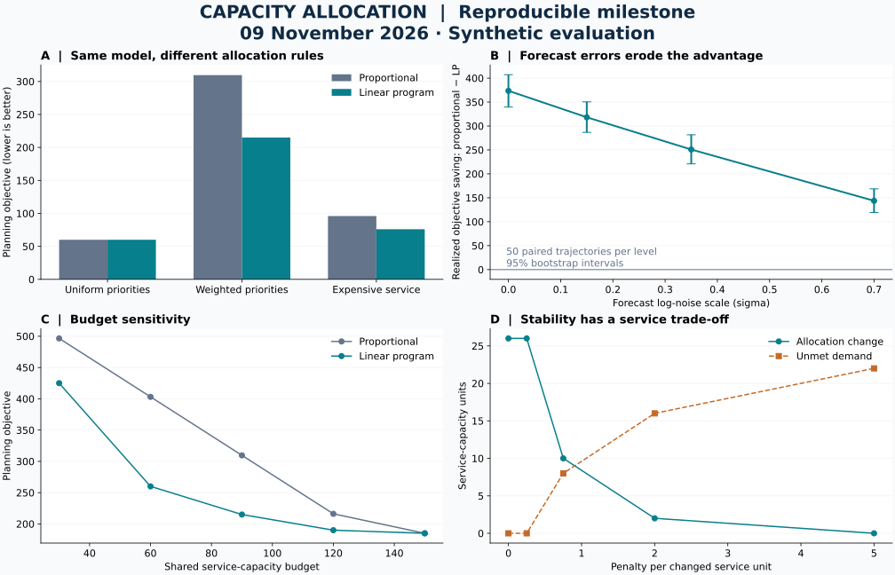

# Milestone 01 — From Formulation to Reproducible Allocation Experiments

**Achievement date: 9 November 2026**

**Evidence level: tested implementation and synthetic computational evaluation**

| Literature foundation | Executable evaluation | Software validation |
|:---:|:---:|:---:|
| **18 reviewed papers** | **218 successful LP solves** | **25 automated tests passed** |
| Sources, limitations, and proposed experiments | 8 fixed cases · 200 stress pairs · 10 sensitivity pairs | Analytical solutions · independent reference checks · full result reproduction |

This milestone completes two concrete advances: **a working multi-period constrained allocator** and **an auditable decision-evaluation package**. It turns the existing mathematical specification into Python code, compares it with the proportional baseline, and publishes the inputs, outputs, algorithms, and limitations needed to inspect the results.

In the synthetic stress test, the optimizer reduced the aggregate weighted objective by **17.18% with exact demand**, falling to **6.20% at the strongest forecast-noise setting**. All 218 LP allocations satisfied the modeled constraints within tolerance. These gains concern the declared weighted objective: unweighted unmet demand was higher on average, and the optimizer lost on one of 50 trajectories at the strongest noise level. The finding is a measurable trade-off, not a claim of universal improvement.



## Achievement 1: A validated optimization implementation

The [Python allocator](../../src/tourism_control/optimization/linear.py) handles multiple locations and periods, local capacity, shared resources, heterogeneous unmet-demand and operating costs, allocation-change penalties, and optional change limits. It calls the established HiGHS dual-simplex solver through SciPy. It reports infeasibility explicitly and independently checks returned plans and primal-dual diagnostics.

The implemented objective is

$$
\min_{x,u,a}\sum_{i,t}\left(w_{i,t}u_{i,t}+c_{i,t}x_{i,t}+\kappa_i a_{i,t}\right),
$$

with demand balance, capacity and budget constraints, and $a_{i,t}\geq|x_{i,t}-x_{i,t-1}|$. The [complete formulation, algorithm, pseudocode, numerical checks, and JSON contract](../../docs/methodology/allocation-algorithm.md) explain every term and implementation boundary.

The implemented work is the application model, sparse constraint construction, validation, and evaluation infrastructure. It is not a claim to have invented linear programming or the solver. Resources are continuous service units; there is no queue, physical occupancy, travel, or individual visitor model.

### What the fixed cases establish

| Case | LP objective | Proportional objective | LP unmet | Proportional unmet | Interpretation |
|---|---:|---:|---:|---:|---|
| Uniform priorities | 60.000 | 60.000 | 60.000 | 60.000 | Expected equality: the heuristic already maximizes total service |
| Weighted priorities | 215.000 | 309.615 | 60.000 | 60.000 | Resource priorities change the distribution of service |
| Expensive service | 76.000 | 96.000 | 70.000 | 50.000 | Lower cost can deliberately leave more demand unmet |
| Temporal coupling | 15.500 | 19.500 | 8.000 | 0.000 | Less allocation change trades off against service |

Closed-location, zero-demand, and zero-budget cases are also retained in the [full table](results.md). A separate change-limited case shows a 10-unit ramp violation by the proportional rule. Its lower objective is **not a valid performance comparison**, because the plans do not share feasibility. The LP's plan satisfies the limit.

## Achievement 2: Reproducible experiments and inspectable findings

The [benchmark runner](../../scripts/evaluation/run_milestone.py) uses a [versioned configuration](../../configs/optimization/milestone-benchmark.json). It evaluates 50 independently seeded trajectories with six periods and four locations, reusing each trajectory across four predeclared forecast-noise levels. That produces 200 paired comparisons, not 200 independent trajectories. Ten additional pairs examine resource budgets and adjustment penalties.

Both methods receive the same planning demand, capacities, costs, and budgets. Forecasts are synthetic lognormal perturbations of realized demand; no learned forecasting model is claimed. The [experimental contract](../../docs/experiments/milestone-2026-11-09.md) records the generator, information available to each method, metric definitions, resampling unit, and failure policy.

### Forecast uncertainty changes decision quality

| Forecast log-noise scale | Forecast MAE | Mean paired objective saving, 95% CI | Aggregate saving | LP worse |
|---:|---:|---:|---:|---:|
| 0.00 | 0.000 | 373.521 [339.608, 407.165] | 17.18% | 0/50 |
| 0.15 | 4.783 | 318.193 [286.728, 350.401] | 14.64% | 0/50 |
| 0.35 | 11.107 | 250.818 [220.926, 281.624] | 11.41% | 0/50 |
| 0.70 | 21.722 | 143.710 [119.412, 168.641] | 6.20% | 1/50 |

Positive savings favor the LP. Intervals use 5,000 bootstrap resamples of whole paired trajectories. They are pointwise Monte Carlo intervals for this synthetic generator, not estimates of real-world tourism benefits. Aggregate percentage saving uses the ratio of total paired savings to total proportional objective, not a mean of individual percentages.

The cost advantage does not imply more total service. At zero noise, average unweighted unmet demand is **434.387 for LP versus 420.081 for proportional allocation**; at noise scale 0.70 it is **487.111 versus 457.746**. The optimizer follows the declared priorities and costs. An operational application would need justified coefficients and, where appropriate, explicit service or fairness constraints.

### Verification evidence

- **218/218** benchmark LP solutions passed feasibility checks at absolute tolerance `1e-7`.
- Maximum observed constraint violation: **1.42 × 10⁻¹⁴** service units.
- Maximum observed absolute primal-dual gap: **2.73 × 10⁻¹²** objective units.
- **25 automated tests passed**, including analytical allocations, a temporal optimum, a small exhaustive reference, 50 independent single-period greedy reference instances, malformed-input rejection, and expected infeasibility.
- A second complete run reproduced the stored scientific inputs, allocations, and metrics within **1e-7**, excluding runtime and solver bookkeeping. The [validation record](validation.json) and [environment/source fingerprints](environment.json) make this claim checkable.

These are software and numerical checks. They do not establish external validity, causal effects, or a new state-of-the-art method. Reported runtimes are single-run wall-clock observations with different method overheads; no solver-speed claim is made.

## Literature, modeling, and implementation coverage

The [literature synthesis](../../docs/related-work/synthesis.md) connects all 18 source-checked notes to seven research areas. The [mathematical framework](../../docs/methodology/mathematical-framework.md) retains broader formulations for forecasting, pricing, recommendation, and grounded assistance.

| Layer | Completed evidence as of this checkpoint | Remaining work |
|---|---|---|
| Literature | 18 individual notes; thematic synthesis; evidence and limitations | Broader and more recent domain-specific coverage |
| Mathematical modeling | Explicit allocation LP, assumptions, units, timing, and broader module specifications | Empirical coefficients, discrete decisions, fairness, queues |
| Algorithms and code | Proportional comparator; sparse LP integration; pseudocode; JSON interface | Robust/stochastic optimization and adaptive policies |
| Experiments | Fixed cases, paired forecast-error tests, sensitivity, CSV/JSON outputs, plotted findings | Historical replay and external validation |
| Sensing, pricing, recommendation, LLM/RAG | Literature and mathematical/interface specifications | Implementations and separately validated integrations |

The study is informed by prediction-to-decision evaluation, explicit constraint handling, and careful uncertainty interpretation. It does not reproduce SPO+, NSGA-II, CPO, neural forecasting, crowd-counting networks, pricing policies, or RAG systems. Their reviewed findings remain attributed to their respective authors.

## Reproduce and inspect

Validated environment: Python **3.13.2**, NumPy **2.5.4**, SciPy **1.18.1**, bundled HiGHS **1.12.0**, and Matplotlib **3.11.2**. Complete dependency versions are pinned in the [lock file](../../requirements-milestone-lock.txt). Other platforms or solver builds may change numerical tie-breaking and runtime.

From the repository root, create and activate an isolated Python 3.13 environment, then run:

```sh
python -m pip install -r requirements-milestone-lock.txt
python src/tourism_control/optimization/linear.py configs/optimization/milestone-example.json
python -m unittest discover -s tests/unit -v
python scripts/evaluation/verify_milestone.py
```

The verifier checks source/configuration fingerprints, runs the tests, and recomputes the reference scientific results without overwriting them. To produce a separate copy of all tables, plots, and raw outputs:

```sh
python scripts/evaluation/run_milestone.py --output reports/local-reproduction
```

| Artifact | Purpose |
|---|---|
| [results.json](results.json) | Every synthetic input, allocation, objective component, diagnostic, and timing |
| [metrics.csv](metrics.csv) | 436 method-level records for independent analysis |
| [summary.json](summary.json) | Aggregate results and uncertainty intervals |
| [results.md](results.md) | Machine-generated comparison tables |
| [results-overview.svg](figures/results-overview.svg) | Reproducible vector figure |
| [environment.json](environment.json) | Interpreter, solver, packages, hardware description, and source hashes |
| [validation.json](validation.json) | Test counts and reproduction outcome |
| [Algorithm documentation](../../docs/methodology/allocation-algorithm.md) | Equations, pseudocode, validation, and interfaces |
| [Experiment contract](../../docs/experiments/milestone-2026-11-09.md) | Exact design and interpretation rules |

## What this checkpoint establishes

The repository now has an executable, tested optimization baseline and a reproducible body of computational evidence. The results expose both useful objective improvements and their service/uncertainty trade-offs. The next research milestone is evaluation with appropriately usable historical observations, meaningful service requirements, and forecast errors measured from chronological validation. That evidence is needed before extending these findings to deployed tourism management.
